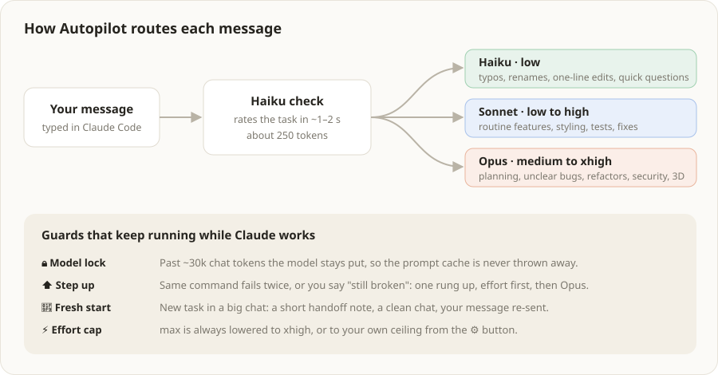
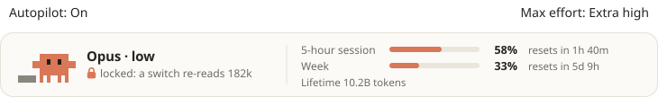

<p align="center">
  
</p>

<p align="center">
  <a href="LICENSE"></a>
  
  
  
</p>

<p align="center">
  <b>Stop paying Opus prices for typo fixes.</b><br/>
  Autopilot picks the right Claude model and effort for every message, keeps your prompt cache alive in long chats, and shows your live usage limits above the prompt.
</p>

---

Most Claude Code sessions run every message on the same big model at the same effort, whether you asked it to plan an architecture or fix a typo. Long chats get worse: switching models rewrites the whole cached conversation, and every new task drags the old history along.

Autopilot fixes that automatically. Install it once and keep working the way you do now.

- **Right effort, every message.** A tiny Haiku check (about 250 tokens) rates each request. Routine work runs on **Sonnet** and hard problems on **Opus**, each at the effort it needs.
- **Cheap search helpers.** Explore and search subagents run on Haiku: they only find and list, and the main chat does the thinking. Other helpers keep their own model.
- **Cache-friendly by design.** In long chats the model is locked so the prompt cache is never thrown away.
- **Always know where you stand.** Your 5-hour and weekly limits, with reset times, live above the prompt.
- **Your choice, feature by feature.** A ⚙ settings card turns each part on or off, and a notice tells you when an update is out.

> **Before you install:** Autopilot is free and open source (MIT). It does make some model calls of its own, can run `/compact` on a long chat, and talks to two web addresses. [What Autopilot does on your computer](#what-autopilot-does-on-your-computer) lists all of it.

<p align="center">
  
</p>
<p align="center"><em>The bar above the prompt in the Claude Code desktop app. In the terminal it is one line of text.</em></p>

## Get started

You need Claude Code, signed in with your Claude account. In Claude Code, run:

```
/plugin marketplace add ImLiquify/claude-autopilot
/plugin install autopilot@autopilot
```

Or from a terminal:

```bash
claude plugin marketplace add ImLiquify/claude-autopilot
```

```bash
claude plugin install autopilot@autopilot
```

Open a new chat. The bar appears above the prompt and routing is on. There is nothing to configure.

### Install from a file, or go back to an older version

Every version is on the [Releases page](https://github.com/ImLiquify/claude-autopilot/releases) with its changes and three installers. Each installs that exact version, or switches to it from the one you have:

| You use | Download | Then |
|---|---|---|
| Windows | `Install-Autopilot-<version>.cmd` | Double-click it |
| Mac or Linux | `install-autopilot-<version>.sh` | Run `bash install-autopilot-<version>.sh` |
| Any system | `Install-Autopilot-<version>.md` | Drop it into a Claude Code chat and say "install this" |

Restart Claude afterwards. To come back to the newest version, press **Update** on the update notice, or run the installer from the latest release. If a version can't be found, the installer changes nothing.

**Plugins only when asked, built in.** Every plugin you install puts its skills' descriptions into every chat, even when you never use them. Autopilot lists other plugins' skills and agents by name only, so Claude still knows they exist and loads one when you ask for it or name it. Plugins that load a long text into every chat at the start (Superpowers, Ponytail) skip it until you ask for them. The app's own skills and your own skills are left whole. Turn it off in ⚙ Settings.

**Lean code, built in.** Every chat gets one short rule (about 170 tokens) that cuts tokens on code work without cutting what you asked for: edit in place instead of reprinting files, read only the lines needed, keep command output small, no extras nobody asked for, no preamble. Writing, advice, design and explanations are left alone and answered in full. Turn it off in ⚙ Settings. If you use [Ponytail](https://github.com/DietrichGebert/ponytail), Settings offers to turn it off: Lean code saves the same kind of tokens, and Ponytail also builds the smallest version of what you ask for, which can make the result plainer.

**One free add-on, one click.** On the first chat, Autopilot offers to install graphify (a map of each project, so Claude reads fewer files; needs Python) if you don't have it. Press **Install graphify** or **Not now**. Nothing is installed without your press, and it stays available in ⚙ Settings.

---

## How it works

<p align="center">
  
</p>

### 1. Every message gets the right model

Before Claude starts on your message, Autopilot asks Haiku one question: *what model and effort does this need?* Autopilot runs exactly that pick. Haiku only routes: your messages are answered by Sonnet or Opus, at the setting that fits the task (Sonnet high stays Sonnet high, not bumped to Opus to be safe).

| You ask for | Autopilot picks |
|---|---|
| Start the server, a typo, a rename, a quick question | **Sonnet · low** |
| Routine features, styling, tests, ordinary bug fixes | **Sonnet · low to high** |
| Planning, architecture, unclear bugs, big refactors, security | **Opus · medium to high** |
| Heavy animation, WebGL / 3D, many files at once | **Opus · xhigh** (shows ⚡ extra effort) |

**You never pick a model.** The check (a small Sonnet call, about 700 tokens) names the kind of request, and each kind has its setting:

- **Small talk, quick facts, mechanical changes** (a typo, a rename, run a command) and **small, clearly specified coding jobs** run on Sonnet.
- **Anything judged by its quality** runs on Opus: advice, opinions, writing or editing text, design, open-ended features, a bug with no known cause, planning, reviews. Short does not mean simple: "make this look better" goes to Opus.
- A message with files or images attached goes to Opus unless the text alone makes it mechanical, because the check cannot see them.

Three guards sit on top:

- **Low effort only if low is your own setting.** Otherwise a "trivial" guess runs at medium.
- **The model never moves down in the middle of a chat.** A switch re-writes the whole chat, which costs more than the cheaper model saves on a small job. Small chats start on Sonnet and stay cheap; the model can also move down after a `/compact` or an hour away.
- **It moves up as soon as a message needs it,** and straight to high effort if you say an answer was wrong.

Most of the saving comes from keeping chats short (section 4). Want it cheaper still? `/route sonnet` runs everything on Sonnet.

Short replies like "yes" or "go on" keep the model you're already on. The check is rate-limited to 60 an hour, and if it ever fails, the message keeps the current route (or your own model and effort on a first message).

### 2. Long chats keep their cache

Claude Code caches your conversation so each new message only pays for what's new. **Switching models throws that cache away** and re-writes the whole conversation, which costs roughly 30× a normal turn in a long chat.

So once a chat passes about 60k tokens, Autopilot **locks the model**. Effort can still go up or down (that keeps the cache), but the model stays put. The bar shows a 🔒 and how many tokens a switch would re-read.

**The lock never costs you quality.** It only holds a chat on its model when the task needs the same model or a weaker one. When a locked chat gets a task that needs a stronger model (Sonnet to Opus), Autopilot first shortens the chat in place with Claude Code's own `/compact`, then the stronger model takes over. You stay in the same chat with its latest messages, so nothing has to be re-explained, and the switch re-writes only the short summary instead of the whole chat. With **Ask me before shortening a chat** on, a card asks first: **Shorten** does this, **Keep going here** runs the task on the stronger model without shortening. If the message has files attached, it switches without shortening. The model is also free to change right after any `/compact` and after an hour away, because the cache is being rebuilt then anyway.

<p align="center">
  
</p>

### 3. It steps up when Claude is stuck

Haiku's guess is checked against what actually happens. Autopilot moves effort **straight up to high** (then Sonnet to Opus) when:

- the same command fails twice,
- Claude keeps re-editing the same spot, or
- you say something like "still broken" or "that didn't fix it".

If Claude gets stuck mid-reply in a long chat, switching models right then would re-write the whole cache, so it doesn't. Instead your next message shortens the chat and continues on the stronger model, as described above (or offers to, if you have Ask me first on). A toast tells you this; there is nothing for you to do.

### 4. Long chats are shortened in place

Every message re-sends the whole chat. A big chat therefore costs more on every message, and answers get vaguer as it grows. Autopilot handles this two ways, depending on whether you are still on the same task:

- **Same task, very long chat** (over about 100k tokens). Autopilot runs Claude Code's own `/compact`, told to keep your exact requests and preferences, decisions, files, open errors and what is half-done. You stay in the same chat: the older part becomes a summary and the latest messages stay as they are, so Claude carries on without you re-explaining anything. This runs when Claude finishes a turn, while the chat is still cheap to summarize, so it also covers messages with files or images. If that did not run, it happens on your next message instead, which is then sent on the shorter chat.
- **A new, unrelated task** (chat over about 60k tokens, and Haiku judges your message unrelated). The old details would only add cost, so Autopilot runs `/compact` with a short summary. You stay in the same chat, your old messages stay, and your message is then sent.

Both sizes can be changed in ⚙ Settings (Sooner, Normal, Later or Never). They count only the conversation, not the setup each chat starts with: the smallest first reply Autopilot has seen.


This happens by itself. If you would rather check first, turn on **Ask me before shortening a chat** in ⚙ Settings. A card then asks: **Shorten** goes ahead, **Keep going here** sends your message in the current chat as it is and asks again once the chat has grown another 50k tokens.

**Nothing is deleted, and `/clear` is never used.** Neither case runs while Claude is still working or on a message with images or files attached (they could not be re-sent; past 150k Autopilot shows a reminder to type /compact instead). A new task never triggers on short replies like "yes" or "still broken". Set either case to Never in ⚙ Settings.

### 5. Effort never runs away

Auto routing never goes above the effort you set in Claude Code; it may go lower. Only `!high`, `!opus`, `!extra`, `/route` or a step up after a stuck run can pass it. `max` effort is always lowered to `xhigh`. Click **Max effort: High** above the bar to set your own ceiling: the choices appear beside it, the current one ticked, and **Done** closes them. The cap holds even with routing off.

The **Autopilot: On** switch on the left of that row turns the whole mod off and on, in every chat at once. Off, Claude Code runs exactly as it would without Autopilot, and the bar shrinks to the switch:

<p align="center">
  
</p>

**Minimize.** Click **▾ Minimize** (top right of the bar) to shrink the card to a single strip: the crab with the model and effort, the 5-hour and Week meters, and your lifetime tokens. The switch, Max effort, to-do list and settings are hidden until you click **▴** to expand again. Update notices and the "Start a new chat?" card still appear. Your choice is remembered across restarts, but is read when a chat starts, so chats already open need a restart to pick it up. The button is hidden while Autopilot is off.

<p align="center">
  
</p>

### 6. Settings

The ⚙ to the right of ＋ on the to-do card opens a **Settings** card. Everything is saved for all your chats at once. **Reset to defaults** at the bottom puts every option back.

**Switches**, each with an On/Off button:

| Option | On (default shown in brackets) | Off |
|---|---|---|
| Lean code (On) | One short rule cuts tokens on code work; writing and advice are answered in full | No rule is added |
| Plugins only when asked (On) | Other plugins' skills and agents are listed by name and load when you ask for them; Superpowers and Ponytail skip their start-up text | Every plugin loads its full descriptions into every chat |
| Pick the best model for each message (On) | Autopilot picks the model and effort | Claude uses the model you picked yourself. The effort cap still applies |
| Ask me before shortening a chat or starting a new one (Off) | A card asks first; you choose | It happens by itself |
| Try harder by itself when Claude gets stuck (On) | Effort, then the model, goes up one step when you say it's wrong or a command keeps failing | Stays where it is until you type `!high` or `!opus` |
| Use the cheapest model for file searches (On) | Search helpers run on Haiku | Search helpers use your main model: costs more, searches slightly better |
| Map each project so Claude reads fewer files (On) | graphify keeps a code map of each project | No map is made or updated |
| Keep a log of why each model was picked (On) | `trace.json` keeps the last 40 decisions, with the first 60 characters of each message | Nothing is logged |
| Tell me when an update is out (On) | Checks GitHub once per chat | No check |

**Sizes**, each a row of choices. The line under each row shows the exact number:

| Option | Choices (default **bold**) | What it means |
|---|---|---|
| Shorten a chat when it gets long | Sooner (70k) · **Normal (100k)** · Later (150k) · Never | Claude re-reads the whole chat for every message, so long chats cost more each time |
| Shorten the chat when I switch to a different task | Sooner (40k) · **Normal (60k)** · Later (100k) · Never | Only for a new, unrelated task. Runs `/compact` with a short summary |
| Stop switching models once a chat is | **Short (30k)** · Medium (60k) · Long (100k) | Switching models in a long chat costs about as much as 30 normal messages. Effort can still change, and the model can again after `/compact` or an hour away |

**Check what uses tokens** (the *Clean* button in ⚙ Settings, or type `/clean`) is a full check of everything that adds tokens to your chats. It makes no model calls except one small Haiku read of your CLAUDE.md:

- **This month's chats:** what a new chat usually starts at, and how many grew past 150k tokens, measured from your own chat logs.
- **Not used:** plugins and skills installed for 14 days or more and not used in the last 30 days of chats (a skill run, a slash command, an agent or a connector tool). Ones you used on only a day or two are listed but not ticked.
- **Duplicates:** a skill installed on its own and inside a plugin. A copy you still use is listed but not ticked.
- **Broken:** a plugin turned on but missing, a plugin with nothing in it, or a skill link that leads nowhere.
- **Costly hooks:** plugins or `settings.json` hooks that run on every message you send or every reply Claude finishes. A Stop hook can make Claude keep working after it is done.
- **CLAUDE.md files:** your global one and the files it imports with `@`, and the CLAUDE.md of each project you worked in this month, when they are long. Haiku also checks the global one for rules that name things you don't have, or that contradict each other.
- **Memory:** a project's memory index that has grown big (it loads in every chat there).
- **MCP servers and your own agents and commands** that you have not used in 30 days.

Each item says why and roughly how many tokens it adds to every message, and the card adds up what the ticked ones save. Two ways to act on it: **Turn off** for plugins and skills, or **Fix with Claude** for the rest (shortening a CLAUDE.md, cleaning memory, removing a hook or an MCP server). Fix with Claude sends the list to the chat, and Claude goes through it with you one change at a time, changing nothing until you say yes.

For Turn off, untick anything you want to keep and press the button: plugins are switched off in `settings.json` (a backup is saved first) and skill folders move to `~/.claude/autopilot/skills-off`. A second question then asks whether to **Delete** them for good (plugins are uninstalled, skill folders removed) or **Keep turned off**. `/clean restore` turns back on everything still turned off. Restart Claude Code afterwards. Plugins the desktop app manages are only reported, with a note to remove them in its plugin settings.

### 7. Update notices

When a chat starts, Autopilot compares its version with the one on GitHub. If GitHub has a newer one, a small notice appears above the bar: **Autopilot 0.21.0 is out**, with **What's new**, **Update** and **Later**. What's new lists every change since your version, from [CHANGELOG.md](CHANGELOG.md). Update runs `claude plugin marketplace update autopilot` and `claude plugin update autopilot@autopilot`; restart Claude Code afterwards to use the new version. If you went back to an older version with an installer, Update takes you to the latest again. If that fails, the notice tells you the command to run yourself. Later hides it for that chat. Nothing updates without your click.

### Extras

- **Everything is in ⚙ Settings.** Nobody has to know a command: the settings card has buttons for *Why did my messages get these models?*, *Shorten this chat now*, *Lean code*, graphify (and *Turn off* for Ponytail, if it is on) and *Clean*, each with one line saying what it does. Clean's findings open right under its button: what to turn off (ticked when unused, unticked when it's your call) and the other suggested changes, which *Fix with Claude* works through with you.
- **Why this model?** `/why` lists the last few messages of this chat with the model and effort each one got, and the reason, in plain words. It also shows when the chat was shortened.
- **Limit warnings.** A toast at 80% and again at 95% of your 5-hour or weekly limit, with the time until it resets, so a long task is not cut off half-way. Once per limit window, across all your chats. Turn it off in ⚙ Settings.
- **This chat's size on the bar.** The bar shows how many tokens Claude re-reads for every message in this chat. When that number is big and you are starting something new, a new chat is cheaper.
- **Hand-off.** A long build or a bulk file job goes to a Sonnet helper with its own small chat, so its steps stop re-reading your chat. Your chat's model writes the brief, checks the result and polishes it. Each hand-off is measured, and they pause by themselves if they stop saving. `/delegate <job>` does it by hand.
- **Coding team.** `/team <goal>` runs a builder, a tester and a reviewer agent in turn. The reviewer can send work back for up to 3 rounds.
- **To-do list.** `/todo <text>` adds a task. A rounded *To-Do List* card appears under the bar: click its title to expand or collapse it, click a task to tick it, or `＋` to add one. The list is shared by all your chats. When Claude finishes work that looks like one of your tasks, it flags it with an orange dot and a one-line reason. You review it and tick it yourself, or press *Not yet*. Claude can read the list and flag items, but only you can tick them.

---

## Commands

| Command | What it does |
|---|---|
| `/route auto` | Automatic routing (the default) |
| `/route opus` · `/route sonnet` | Always use one model |
| `/route off` | Your own model. The effort cap still applies |
| `/fresh on` · `/fresh off` | Turn shortening on a new task on or off |
| `/why` | Why each recent message got the model it did |
| `/delegate <job>` | Hand a long job to a helper with its own small chat, then check its work |
| `/team <goal>` | Builder, tester and reviewer agents work a coding goal together |
| `/todo <text>` · `/todo done <n>` · `/todo clear` | Add, tick or clear to-dos (shared by all your chats) |
| `/clean` · `/clean restore` | Find unused, duplicate or broken plugins and skills, turn them off, then ask to delete · undo the turn-off |

**Per-message overrides.** Start a message with one of these to skip the check:

| Prefix | Runs on |
|---|---|
| `!opus` | Opus · high |
| `!sonnet` | Sonnet · medium |
| `!high` | Current model at high effort |
| `!extra` | Opus · xhigh |

---

## In the terminal

The same information as one line above the prompt:

```text
🤖 Opus · medium · normal task │ 5-hour session ▓▓▓░░░░░ 42% · resets in 2h 14m │ Week ▓▓░░░░░░ 31% · resets in 3d 20h
```

---

## Requirements

- **Claude Code** with plugin support, signed in with a Claude account. The usage bar reads the same numbers as `/usage`.
- **Optional:** `node` on your PATH, for the lifetime-token count on the bar.
- **Optional:** graphify. If it's installed, Autopilot builds and refreshes a code graph in each project after edits. This makes no model calls. Without graphify, this step is skipped.

## What Autopilot does on your computer

A full list, so you know what you are installing.

**Model calls it makes on your account** (these count toward your usage limits):

| When | Model | Size |
|---|---|---|
| Each message you type (at most 60 an hour) | Haiku | about 250 tokens |
| Shortening a chat | Your current model, through `/compact` | reads the chat and writes its summary |
| Shortening a long chat | Claude Code's own `/compact` | the same call `/compact` makes |
| Pressing **Clean** | Haiku | reads your global CLAUDE.md once, about 2-4k tokens |

It also changes which model and effort your own messages run on. That is the point of the mod; ⚙ settings or the On/Off switch stop it.

**Changes to your chats:** shortening runs `/compact` on the chat and re-sends your message there. Autopilot never runs `/clear` and never starts another chat. With *Plugins only when asked* on, the list of other plugins' skills and agents Claude reads is shortened to their names; the plugins themselves are not changed.

**Changes to your files:** pressing **Update** on a copy that an installer pinned to an older version removes that pin from the `autopilot` entry in `~/.claude/settings.json`, and nothing else in it.

**Web addresses it contacts:**

| Address | Why | How often |
|---|---|---|
| `api.anthropic.com/api/oauth/usage` | Your 5-hour and weekly usage, the same numbers `/usage` shows. It uses your Claude sign-in, handled by Claude Code; the mod never sees your token | Every 5 seconds while Claude works, every 30 seconds otherwise. If it fails, it waits longer each time (up to 10 minutes) and the bar says "usage unavailable" rather than showing old numbers |
| `raw.githubusercontent.com/ImLiquify/claude-autopilot/...` | Checks for a newer version, and reads `CHANGELOG.md` when there is one. Nothing about you is sent | Once per chat start (turn off in ⚙) |

**Programs it runs:**

| Program | Why | When |
|---|---|---|
| `node bin/lifetime.js` | Adds up your lifetime tokens from Claude Code's own files on your computer (`stats-cache.json` and chat logs). Only the total is shown; nothing is sent anywhere | After each reply |
| `graphify update .` | Builds a code map in your project, in a `graphify-out/` folder inside it. No model calls | When a chat opens in a project with no map, and after Claude edits files. Only in git projects or folders that already have a map, never in your home folder (turn off in ⚙; skipped if graphify isn't installed) |
| `claude plugin marketplace update` / `claude plugin update` | Installs an update | Only when you press **Update** |
| `node bin/clean.js` | Lists your plugins, skills, agents and commands, reads `settings.json`, `~/.claude.json` (MCP servers), CLAUDE.md files and memory indexes for their size, and reads the last 30 days of chat logs for what was used and how big chats got. Nothing is sent anywhere | Only when you press **Clean**, **Turn off** or **Delete**, or type `/clean restore` |
| `claude plugin uninstall` | Removes a plugin you chose to delete | Only when you press **Delete** |
| `claude plugin disable ponytail@ponytail` | Turns Ponytail off (it stays installed) | Only when you press **Turn off** for it |
| `uv tool install graphifyy` (or `pipx install graphifyy`, or `python -m pip install --user graphifyy`: the first one your computer has) | Installs graphify | Only when you press **Install** for it |
| `graphify --version` | Checks whether graphify is installed | When you open ⚙ Settings |

**Files it writes,** in an `autopilot/` folder beside the installed plugin, never sent anywhere:

| File | What's in it |
|---|---|
| `usage.json` | The latest usage reading, shared between your open chats |
| `trace.json` | The last 40 routing decisions, with the first 60 characters of each prompt, for debugging (turn off in ⚙) |
| `handoffs/` | Notes from older versions; nothing new is written here |
| `skills-off/`, `clean-off.json`, `settings-before-clean-*.json` | Skills you turned off with Clean, the list `/clean restore` undoes, and a copy of `settings.json` from before each turn-off |

Your to-do list and settings are kept in Claude Code's own plugin storage. Graphify adds `graphify-out/` to each project, as described above. In a git project, Autopilot also adds `graphify-out/` to `.git/info/exclude`, git's private ignore list, so the map never ends up in your commits and nothing shared (like `.gitignore`) is changed.

**Make Claude use the map.** The map only saves tokens if Claude reads it before opening files. In a chat whose folder has a map, Autopilot adds a one-line rule to Claude's instructions telling it to query the map first (skipped if your `~/.claude/CLAUDE.md` already has a graphify rule). Nothing is written to your files.

**What Claude sees:** a `todo` tool, so Claude can read your list and flag finished items, and the `autopilot:builder`, `autopilot:tester` and `autopilot:reviewer` agents used by `/team`, and the `autopilot:worker` and `autopilot:expert` helpers used by the hand-off.

## FAQ

**Does the Haiku check cost more than it saves?**
It's about 250 tokens on Haiku per message. It picks the effort and spots new tasks, so a long chat can be shortened when you change task, which is where most of the savings come from.

**Will it ever pick a model that's too weak?**
Haiku is told to name the higher setting when it is torn, Opus handles anything that needs deep reasoning. If Claude gets stuck, Autopilot steps up by itself, and you can always prefix `!opus` for high effort.

**Can I turn it off?**
Each feature has an On/Off button in ⚙ settings. The **Autopilot: On** switch turns the whole mod off in every chat. To remove it, run `/plugin` and uninstall it.

**Does it cost money?**
The mod is free. Its own model calls, listed above, count toward your Claude usage like any other message.

## Development

```bash
claude plugin test
```

```bash
claude plugin validate
```

Routing rules live in `hooks/logic.ts` (pure functions, unit-tested). The hooks are in `hooks/register.tsx` and the bar drawing is in `hooks/banner.ts`. The images in `docs/` are drawn by the mod's own `bannerSvg`.

## License

MIT © Mohamed Kaiser
