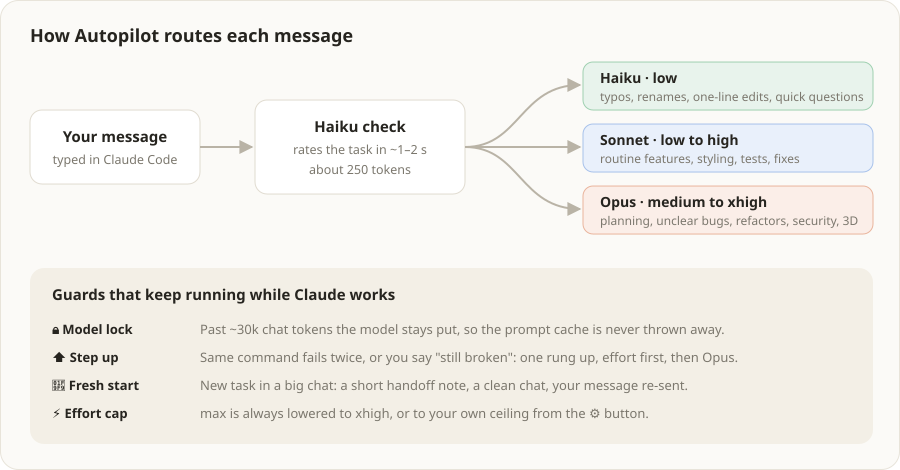
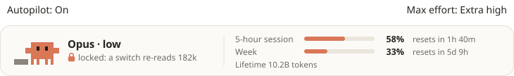

<p align="center">
  
</p>

<p align="center">
  <a href="LICENSE"></a>
  
  
  
</p>

<p align="center">
  <b>Stop paying Opus prices for typo fixes.</b><br/>
  Autopilot picks the right Claude model and effort for every message, keeps your prompt cache alive in long chats, and shows your live usage limits above the prompt.
</p>

---

Most Claude Code sessions run every message on the same big model at the same effort, whether you asked it to plan an architecture or fix a typo. Long chats get worse: switching models rewrites the whole cached conversation, and every new task drags the old history along.

Autopilot fixes that automatically. Install it once and keep working the way you do now.

- **Right effort, every message.** A tiny Haiku check (about 250 tokens) rates each request. It never runs below **Opus · medium** and moves up to high or xhigh for hard work.
- **Cache-friendly by design.** In long chats the model is locked so the prompt cache is never thrown away.
- **Always know where you stand.** Your 5-hour and weekly limits, with reset times, live above the prompt.
- **Your choice, feature by feature.** A ⚙ settings card turns each part on or off, and a notice tells you when an update is out.

> **Before you install:** Autopilot is free and open source (MIT). It does make some model calls of its own, can clear a long chat and continue it in a fresh one, and talks to two web addresses. [What Autopilot does on your computer](#what-autopilot-does-on-your-computer) lists all of it.

<p align="center">
  
</p>
<p align="center"><em>The bar above the prompt in the Claude Code desktop app. In the terminal it is one line of text.</em></p>

## Get started

You need Claude Code, signed in with your Claude account. In Claude Code, run:

```
/plugin marketplace add ImLiquify/claude-autopilot
/plugin install autopilot@autopilot
```

Or from a terminal:

```bash
claude plugin marketplace add ImLiquify/claude-autopilot
```

```bash
claude plugin install autopilot@autopilot
```

Open a new chat. The bar appears above the prompt and routing is on. There is nothing to configure.

---

## How it works

<p align="center">
  
</p>

### 1. Every message gets the right model

Before Claude starts on your message, Autopilot asks Haiku one question: *how hard is this?* The turn runs on the answer, but never below **Opus · medium**. Cheaper picks saved tokens and then cost re-prompts, so since 0.14.1 Autopilot only moves up.

| You ask for | Autopilot picks |
|---|---|
| A typo, a quick question, routine features, ordinary bug fixes | **Opus · medium** |
| Planning, architecture, unclear bugs, big refactors, security | **Opus · medium to high** |
| Heavy animation, WebGL / 3D, many files at once | **Opus · xhigh** (shows ⚡ extra effort) |

Short replies like "yes" or "go on" keep the model you're already on. The check is rate-limited to 60 an hour, and if it ever fails, the message keeps the current route (or Opus · medium on a first message). Want it cheaper? `/route sonnet` runs everything on Sonnet..

### 2. Long chats keep their cache

Claude Code caches your conversation so each new message only pays for what's new. **Switching models throws that cache away** and re-writes the whole conversation, which costs roughly 30× a normal turn in a long chat.

So once a chat passes about 30k tokens, Autopilot **locks the model**. Effort can still go up or down (that keeps the cache), but the model stays put. The bar shows a 🔒 and how many tokens a switch would re-read.

<p align="center">
  
</p>

### 3. It steps up when Claude is stuck

Haiku's guess is checked against what actually happens. Autopilot moves **one rung up** in effort when:

- the same command fails twice,
- Claude keeps re-editing the same spot, or
- you say something like "still broken" or "that didn't fix it".

In a very long chat, a model switch is refused if rewriting the cache would cost more than about $0.40. You get a toast explaining why, and `!opus` still forces it.

### 4. Fresh starts for new tasks and very long chats

Every message re-sends the whole chat. A big chat therefore costs more on every message, and answers get vaguer as it grows. Autopilot moves you to a fresh chat in two cases:

- **A new task.** The chat is over about 60k tokens and Haiku judges your message to be unrelated to what came before. Haiku writes the handoff note.
- **A very long chat.** The chat is over about 150k tokens, even if you are still on the same task. **Sonnet** writes this note, because the next chat continues from it alone, and it records what is half-done and in which files.

Either way, Autopilot:

1. writes a short handoff note (what was done, files, decisions, next steps),
2. saves it under `autopilot/handoffs/`,
3. clears the chat, carries the note over, and re-sends your message.

**Nothing is deleted.** The note includes `claude --resume <id>` for the old chat. It never happens while Claude is still working or on a message with images or files attached (they could not be re-sent; past 150k Autopilot shows a reminder to type /clear instead). A new task in a shorter chat never moves on short replies like "yes" or "still broken", but past 150k even those move, and the note quotes the question Claude last asked. The trade-off: the fresh chat knows only what the note says. Turn either case off in ⚙ settings.

### 5. Effort never runs away

`max` effort is always lowered to `xhigh`. Click **Max effort: High** above the bar to set your own ceiling: the choices appear beside it, the current one ticked, and **Done** closes them. The cap holds even with routing off.

The **Autopilot: On** switch on the left of that row turns the whole mod off and on, in every chat at once. Off, Claude Code runs exactly as it would without Autopilot, and the bar shrinks to the switch:

<p align="center">
  
</p>

<p align="center">
  
</p>

### 6. Settings

The ⚙ to the right of ＋ on the to-do card opens a **Settings** card. Each option has an On/Off button, is saved for all your chats, and is on by default:

| Option | What turning it off does |
|---|---|
| Pick the best model for each message | Claude uses the model you picked yourself. The effort cap still applies |
| New chat when I start a different task | New tasks stay in the current chat |
| New chat when a chat gets very long | Long chats keep growing until you clear them yourself |
| Map each project so Claude reads fewer files | graphify is no longer run in your projects |
| Tell me when an update is out | Autopilot stops checking GitHub for new versions |

### 7. Update notices

When a chat starts, Autopilot compares its version with the one on GitHub. If GitHub has a newer one, a small notice appears above the bar: **Autopilot 0.15.0 is out**, with **Update** and **Later**. Update runs `claude plugin marketplace update autopilot` and `claude plugin update autopilot@autopilot`; restart Claude Code afterwards to use the new version. If that fails, the notice tells you the command to run yourself. Later hides it for that chat. Nothing updates without your click.

### Extras

- **Coding team.** `/team <goal>` runs a builder, a tester and a reviewer agent in turn. The reviewer can send work back for up to 3 rounds.
- **To-do list.** `/todo <text>` adds a task. A rounded *To-Do List* card appears under the bar: click its title to expand or collapse it, click a task to tick it, or `＋` to add one. The list is shared by all your chats. When Claude finishes work that looks like one of your tasks, it flags it with an orange dot and a one-line reason. You review it and tick it yourself, or press *Not yet*. Claude can read the list and flag items, but only you can tick them.

---

## Commands

| Command | What it does |
|---|---|
| `/route auto` | Automatic routing (the default) |
| `/route opus` · `/route sonnet` | Always use one model |
| `/route off` | Your own model. The effort cap still applies |
| `/fresh on` · `/fresh off` | Turn fresh starts on or off |
| `/team <goal>` | Builder, tester and reviewer agents work a coding goal together |
| `/todo <text>` · `/todo done <n>` · `/todo clear` | Add, tick or clear to-dos (shared by all your chats) |

**Per-message overrides.** Start a message with one of these to skip the check:

| Prefix | Runs on |
|---|---|
| `!opus` | Opus · high |
| `!sonnet` | Sonnet · medium |
| `!high` | Current model at high effort |
| `!extra` | Opus · xhigh |

---

## In the terminal

The same information as one line above the prompt:

```text
🤖 Opus · medium · normal task │ 5-hour session ▓▓▓░░░░░ 42% · resets in 2h 14m │ Week ▓▓░░░░░░ 31% · resets in 3d 20h
```

---

## Requirements

- **Claude Code** with plugin support, signed in with a Claude account. The usage bar reads the same numbers as `/usage`.
- **Optional:** `node` on your PATH, for the lifetime-token count on the bar.
- **Optional:** graphify. If it's installed, Autopilot builds and refreshes a code graph in each project after edits. This makes no model calls. Without graphify, this step is skipped.

## What Autopilot does on your computer

A full list, so you know what you are installing.

**Model calls it makes on your account** (these count toward your usage limits):

| When | Model | Size |
|---|---|---|
| Each message you type (at most 60 an hour) | Haiku | about 250 tokens |
| A fresh start for a new task | Haiku | reads the chat (up to about 50k tokens), writes up to 900 |
| A fresh start for a very long chat | Sonnet | reads the chat (up to about 50k tokens), writes up to 900 |

It also changes which model and effort your own messages run on. That is the point of the mod; ⚙ settings or the On/Off switch stop it.

**Changes to your chats:** a fresh start clears the current chat and re-sends your message in a new one. The old chat stays saved and can be reopened with `claude --resume <id>`.

**Web addresses it contacts:**

| Address | Why | How often |
|---|---|---|
| `api.anthropic.com/api/oauth/usage` | Your 5-hour and weekly usage, the same numbers `/usage` shows. It uses your Claude sign-in, handled by Claude Code; the mod never sees your token | Every 5 seconds while Claude works, every 30 seconds otherwise |
| `raw.githubusercontent.com/ImLiquify/claude-autopilot/...` | Checks for a newer version. Nothing about you is sent | Once per chat start (turn off in ⚙) |

**Programs it runs:**

| Program | Why | When |
|---|---|---|
| `node bin/lifetime.js` | Adds up your lifetime tokens from Claude Code's own files on your computer (`stats-cache.json` and chat logs). Only the total is shown; nothing is sent anywhere | After each reply |
| `graphify update .` | Builds a code map in your project, in a `graphify-out/` folder inside it. No model calls | When a chat opens in a project with no map, and after Claude edits files (turn off in ⚙; skipped if graphify isn't installed) |
| `claude plugin marketplace update` / `claude plugin update` | Installs an update | Only when you press **Update** |

**Files it writes,** in an `autopilot/` folder beside the installed plugin, never sent anywhere:

| File | What's in it |
|---|---|
| `usage.json` | The latest usage reading, shared between your open chats |
| `trace.json` | The last 40 routing decisions, with the first 60 characters of each prompt, for debugging |
| `handoffs/` | The notes written at each fresh start |

Your to-do list and settings are kept in Claude Code's own plugin storage. Graphify adds `graphify-out/` to each project, as described above.

**What Claude sees:** a `todo` tool, so Claude can read your list and flag finished items, and the `autopilot:builder`, `autopilot:tester` and `autopilot:reviewer` agents used by `/team`.

## FAQ

**Does the Haiku check cost more than it saves?**
It's about 250 tokens on Haiku per message. It picks the effort and spots new tasks, so a long chat can move to a fresh one, which is where most of the savings come from.

**Will it ever pick a model that's too weak?**
No. On auto it never goes below Opus · medium. If Claude gets stuck, Autopilot steps up by itself, and you can always prefix `!opus` for high effort.

**Can I turn it off?**
Each feature has an On/Off button in ⚙ settings. The **Autopilot: On** switch turns the whole mod off in every chat. To remove it, run `/plugin` and uninstall it.

**Does it cost money?**
The mod is free. Its own model calls, listed above, count toward your Claude usage like any other message.

## Development

```bash
claude plugin test
```

```bash
claude plugin validate
```

Routing rules live in `hooks/logic.ts` (pure functions, unit-tested). The hooks are in `hooks/register.tsx` and the bar drawing is in `hooks/banner.ts`. The images in `docs/` are drawn by the mod's own `bannerSvg`.

## License

MIT © Mohamed Kaiser
